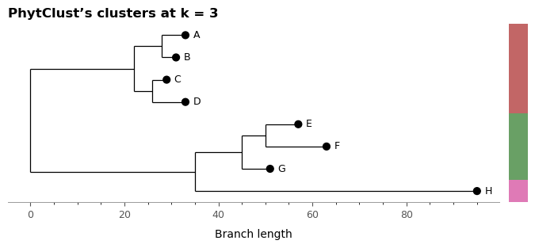

# Reference

## CLI

Pass a Newick file as `TREE`, or use `-` to read the tree from standard input.
The `gui` subcommand starts the web interface.

```bash
phytclust TREE [options]     # TREE is a Newick file, or - for stdin
phytclust gui [options]      # web interface
```

| Flag | Default | Meaning |
|------|---------|---------|
| `-k, --k` | — | Exactly this many clusters |
| `--top-n` | `1` | Maximum number of ranked peaks to return |
| `--resolution` | off | One peak per logarithmic bin |
| `--bins` | `3` | Number of bins for `--resolution` |
| `--max-k` | — | Upper bound on *k*; default `ceil(max_k_limit · n_leaves)` |
| `--max-k-limit` | `0.9` | Default upper bound on *k*, as a fraction of the leaf count |
| `--outgroup` | — | Taxon or clade name to remove before clustering |
| `--root-taxon` | — | Re-root on this taxon, or `midpoint` |
| `--min-cluster-size` | `1` | Hard minimum cluster size |
| `--outlier-size-threshold` | — | Clusters below this size are written as `-1` |
| `--prefer-fewer-outliers` | off | Minimise small-cluster count before partition cost; counts singletons when no threshold is set |
| `--no-outlier` | off | Do not mark small clusters `-1` in the TSV |
| `--polytomy-mode` | `soft` | `soft` allows clusters spanning a subset of child subtrees; `hard` allows only the whole subtree or clusters within individual children |
| `--soft-polytomy-max-degree` | `12` | Soft mode refuses nodes above this degree |
| `--no-split-zero-length` | off | Keep clades whose branches are all zero together |
| `--prominence-weight` | `0.7` | `1` ranks peaks by prominence, `0` by score height |
| `--exclude-k2` | off | Drop *k* = 2 from automatic selection |
| `--peak-partition-preference` | `none` | Re-rank peaks by `fewer_outliers` or `balanced` cluster sizes |
| `--peak-partition-weight` | `0.5` | `1` ranks by partition quality alone |
| `--config` | — | YAML file of settings; flags override it |
| `-o, --out-dir` | `results/` | Output directory |
| `--tsv-name` | `phytclust_results.tsv` | Assignment table name |
| `--save-fig` | off | Write `scores.png` and `tree_k*.png` |
| `--save-tree` | off | Write the tree PNGs only |
| `--save-all-k` | off | One TSV column for every *k* from 1 to `max_k` |
| `--no-tsv` | off | Skip the assignment table |
| `--dpi` | `150` | PNG resolution |
| `--plot` | off | Open interactive plot windows |
| `-v`, `-q` | — | Increase or reduce logging output |
| `--log-format` | `%(message)s` | Python `logging` format string for log lines |
| `--time`, `--progress`, `--no-color`, `--version` | — | Timing, spinner, plain output, version |

`phytclust gui` accepts `--host` (default `127.0.0.1`), `--port` (default
`8000`), `--no-browser` and `--reload`. By default, the server accepts requests
from localhost only.

## Configuration

`PeakConfig` controls automatic selection of *k*. `RuntimeConfig` contains
plot and output settings. Pass these objects to the `PhytClust` constructor;
`peak_config=` can also override the peak settings for a single `run()` call.
For the CLI, use the corresponding sections in a YAML file:

```yaml
peak:
  prominence_weight: 0.7
  min_prominence: 5.0
runtime:
  plot:
    scores:  { log_scale_y: false, fig_width: 22 }
    cluster: { height_scale: 0.25, marker_size: 55 }
  save:     { tsv_name: phytclust_results.tsv, outlier: true }
```

The YAML loader also accepts `plot:` and `save:` at the top level, without a
`runtime:` section. Unknown keys produce a warning and are ignored.

### PeakConfig

| Field | Default | Meaning |
|-------|---------|---------|
| `prominence_weight` | `0.7` | Blend for `ranking_mode="adjusted"`: `1` ranks by prominence only, `0` by score height only |
| `ranking_mode` | `"adjusted"` | `"adjusted"` min–max normalises prominence and score, then blends them; `"raw"` ranks by absolute prominence and ignores the weight |
| `min_prominence` | `None` | Minimum peak prominence; `None` uses 1 % of the score range |
| `min_k` | `2` | Smallest *k* considered |
| `exclude_k2` | `False` | Drop *k* = 2 from automatic selection; an explicit `k=2` is always honoured |
| `resolution_fallback_mode` | `"none"` | Resolution mode only. `"none"` leaves a bin without a peak empty; `"max_score"` returns its highest-scoring *k* |
| `resolution_min_scores` | `50` | Minimum number of scored *k* values for resolution mode; below this, a warning is issued and a global top-3 search runs |
| `partition_preference` | `"none"` | Re-rank detected peaks: `"fewer_outliers"` prefers fewer singleton clusters, `"balanced"` also prefers even sizes |
| `partition_weight` | `0.5` | `0` keeps the peak ranking, `1` ranks by partition quality alone |
| `boundary_window_size` | `5` | Window to the right of *k* = 2 used by the boundary test |
| `boundary_ratio_threshold` | `1.5` | Minimum ratio of score(2) to the window median for *k* = 2 to pass |
| `use_relative_prominence` | `False` | Measure prominence as peak-to-baseline ratio |
| `min_relative_prominence` | `None` | Minimum ratio with relative prominence |
| `use_log_peak_input` | `False` | Detect peaks on log(score + `log_peak_offset`) |
| `log_peak_offset` | `1e-12` | Offset used with log input |
| `prominence_k_power` | `0.0` | Scale `min_prominence` by *k* to this power |

Partition preferences reorder detected peaks while retaining the partitions
and score curve. The `"fewer_outliers"` quality is
`1 − singletons / leaves`. The `"balanced"` quality multiplies this by
`leaves² / (k · Σ size²)`, which equals one when cluster sizes are equal.
Invalid `ranking_mode` or `resolution_fallback_mode` values raise
`ConfigurationError`; the accepted sets are `RANKING_MODES` and
`RESOLUTION_FALLBACK_MODES` in `phytclust.config`.

### OutlierConfig

| Field | Default | Meaning |
|-------|---------|---------|
| `size_threshold` | `None` | Clusters with fewer leaves are outliers. `None` means singletons when `prefer_fewer=True` |
| `prefer_fewer` | `False` | Minimise outlier count first, then partition cost |
| `penalty_enabled` | `False` | Add a cost penalty for small clusters (needs a threshold; binary trees) |
| `ratio_weight` | `10.0` | Penalty weight; `0` disables it |
| `ratio_mode` | `"exp"` | Penalty shape: `exp(shortfall) − 1`, `inverse` cluster size, or linear `power` |

By default, exported tables mark clusters below `size_threshold` with ID
`-1`. If no threshold is set, only singletons are marked. Set
`SaveConfig.outlier=False` to keep the original cluster IDs in the table.

### ScorePlotConfig

| Field | Default | Meaning |
|-------|---------|---------|
| `fig_width`, `fig_height` | `9`, `5` | Figure size in inches |
| `log_scale_y` | `True` | Logarithmic score axis |
| `x_axis_mode` | `"log"` | `"log"` or `"linear"` *k* axis |
| `log_base` | `None` | Log base; `None` is 10 |
| `clamp_negative_to_zero` | `True` | Show negative scores as zero |
| `score_plot_from_k3` | `False` | Start the curve at *k* = 3 instead of 2 |
| `show_secondary_score_plot` | `False` | Also build the curve from the other start |
| `title_fontsize`, `axis_label_fontsize`, `tick_labelsize`, `peak_labelsize`, `bin_labelsize` | `20`, `18`, `14`, `16`, `14` | Font sizes |
| `title_fontfamily` | `"Liberation Sans"` | Title font; falls back to DejaVu Sans |
| `peak_marker`, `peak_markersize` | `"o"`, `7` | Peak markers |
| `colorblind_palette` | `None` | Colours for resolution bands |

### ClusterPlotConfig

| Field | Default | Meaning |
|-------|---------|---------|
| `cmap` | `"phytclust"` | Palette; any Matplotlib colormap name |
| `width_scale`, `height_scale` | `2.0`, `0.1` | Figure width, and height per leaf |
| `marker_size` | `40` | Leaf marker size |
| `show_branch_lengths` | `False` | Label branches with their lengths |
| `hide_internal_nodes` | `True` | Hide internal node markers |

### SaveConfig

| Field | Default | Meaning |
|-------|---------|---------|
| `tsv_name` | `"phytclust_results.tsv"` | Assignment table name |
| `outlier` | `True` | Mark outlier clusters `-1` |

## Python API

```python
from phytclust import PhytClust

pc = PhytClust("tree.nwk")
```

The input can also be a Newick string or a `Bio.Phylo` tree. Supplied tree
objects are modified during preparation; pass a copy to retain the original.
Clustering options such as `min_cluster_size`, `polytomy_mode` and
`no_split_zero_length` are constructor arguments. Pass configuration objects
with `peak_config=`, `outlier=` and `runtime_config=`.

### `run()`

```python
pc.run(k=5)                                        # fixed k
pc.run(top_n=3, max_k=120)                         # global peaks, best first
pc.run(by_resolution=True, num_bins=4, max_k=120)  # one peak per bin, increasing k
```

`k` cannot be combined with `by_resolution` or `top_n > 1`. Pass
`peak_config=` to override the constructor's peak settings for that call, or
`plot_scores=False` to skip the score figure. A run's mode does not affect
later calls. `pc.exact_k` records the fixed *k* from the most recent run, or
`None` after a peak search.

`run()` returns a dictionary with these entries:

| Key | Contents |
|-----|----------|
| `mode` | `"k"`, `"global"` or `"resolution"` (a resolution run that fell back reports `"global"`) |
| `k_values` | Selected *k*, in rank order (global) or increasing (resolution) |
| `selected_k` | First of `k_values`, or `None` |
| `clusters` | One `{leaf: cluster id}` map per selected *k* |
| `scores` | Score per *k* from 1 to `max_k`; `None` for a fixed *k* |
| `alphas` | α statistic per selected *k* |

After a run, `pc.zero_length_splits` maps each selected *k* to the number of
zero-distance leaf groups it separates; a warning is logged when it is
non-empty.

### Other methods

```python
pc.get_clusters(7)                                     # any k up to max_k; cached
pc.plot(results_dir="out", save=True, top_n=3)         # one tree figure per k
pc.save(results_dir="out", top_n=3)                    # TSV, alphas.tsv, peaks_by_rank.txt
pc.alpha_info(7)                                       # α statistic for one k
```

`plot()` and `save()` default to `top_n=1`. Unless overridden in the call,
`save()` uses the filename and outlier-marking settings in
`runtime_config.save`. Cluster maps use `Bio.Phylo` leaf objects as keys;
access `leaf.name` for the label. Returned maps retain their cluster IDs.
Outlier marking applies only to the exported table.

## Plotting

```python
pc.plot(k=5, save=True, results_dir="figures", show_cluster_bars=True)
```

Plot a specific *k* or use `top_n` for selected partitions. Omitted options
use the object's `ClusterPlotConfig` settings.

| Argument | Default | Effect |
|---|---|---|
| `k` / `top_n` | `top_n=1` | A specific *k*, or the top-*n* selected peaks |
| `layout` | `"rectangular"` | `"rectangular"` (phylogram) or `"cladogram"` |
| `show_cluster_bars` | `False` | Coloured bars beside the leaves |
| `show_cluster_boxes` | `False` | Translucent box from each cluster's ancestor to its leaves; outliers dashed |
| `colour_branches_by_cluster` | `False` | Colour the branches inside each cluster |
| `show_terminal_labels` | `False` | Leaf names |
| `label_func` | `None` | Callable mapping a leaf to its label |
| `show_branch_lengths` | `False` | Branch-length labels |
| `show_branch_axis` | `True` | Branch-length axis; hidden for cladograms |
| `hide_internal_nodes` | `True` | Hide internal node markers |
| `palette` | `None` | Colours (hex or RGB) for clusters in id order; repeats with a warning if too short |
| `cmap` | `"phytclust"` | Colormap when `palette` is not given; continuous maps are sampled evenly |
| `width_scale`, `height_scale` | `2.0`, `0.1` | Figure width, and height per leaf |
| `marker_size` | `40` | Leaf marker size |
| `title` | `None` | Figure title; `""` for none |
| `save`, `results_dir`, `filename`, `dpi` | `False`, `None`, `tree_k{k}.png`, `180` | Output |

With `show_cluster_bars=True`:


